# Kết quả khám phá dữ liệu (EDA)

Chạy lúc 07/11/2026 21:23 trên file `Du_lieu.csv`. Báo cáo chỉ chứa số liệu tổng hợp: không có Mã SV, mọi nhóm đều có ≥ 5 người.

**Chú giải:** `n` / `so_sv` = số sinh viên khác nhau · `so_luot` = số dòng điểm · `tb` = trung bình · `sigma` = độ lệch chuẩn · `ty_le_A` = tỷ lệ HP ≥ 8,5 · `ty_le_hp_0` = tỷ lệ HP = 0 · `z` = số độ lệch chuẩn cách trung bình · `p_value` < 0,05 thường coi là khác biệt có ý nghĩa thống kê. Thống kê điểm lớp tính trên SV có HP > 0 (điểm 0 gồm cả vắng thi).

## 1. Chất lượng dữ liệu

### 1.1 Đối chiếu với mô tả của BTC

| chi_so | theo_mo_ta | thuc_te | khop |
|---|---|---|---|
| Số dòng (lượt điểm) | 38,342 | 38,342 | ✅ |
| Số cột | 19 | 19 | ✅ |
| Số sinh viên | 5,067 | 5,067 | ✅ |
| Số lớp học phần | 877 | 877 | ✅ |
| Số môn | 93 | 93 | ✅ |
| Số dòng đồ án/TT/KL | 2,103 | 2,103 | ✅ |
| Số dòng lớp EP | 2,726 | 2,726 | ✅ |
| Số dòng học kỳ 3 | 563 | 563 | ✅ |
| TKB – số dòng | 1,170 | 1,170 | ✅ |
| TKB – số cột | 18 | 18 | ✅ |
| TKB – số Mã LHP | 1,090 | 1,090 | ✅ |

### 1.2 Lỗi theo từng cột (đủ 19 cột)

Tổng: **2** loại lỗi có xuất hiện trên 43 phép kiểm tra. Số 0 = đã kiểm tra và không thấy lỗi. Ô trống ở cột điểm, Khóa SV (0.11%) và Cơ cấu trọng số được mô tả cho phép nên không tính là lỗi.

| cot | loai_loi | don_vi | so_luong |
|---|---|---|---|
| Năm học | trống (cột bắt buộc) | ô | 0 |
| Năm học | sai định dạng | ô | 0 |
| Học kỳ | trống (cột bắt buộc) | ô | 0 |
| Học kỳ | không đọc được (chữ thay vì số) | ô | 0 |
| Học kỳ | ngoài khoảng cho phép | ô | 0 |
| Mã môn | trống (cột bắt buộc) | ô | 0 |
| Mã môn | sai định dạng | ô | 0 |
| Nhóm môn | trống (cột bắt buộc) | ô | 0 |
| Nhóm môn | sai định dạng | ô | 0 |
| Số TC | trống (cột bắt buộc) | ô | 0 |
| Số TC | không đọc được (chữ thay vì số) | ô | 0 |
| Số TC | ngoài khoảng cho phép | ô | 0 |
| Là đồ án/thực tập/khóa luận | trống (cột bắt buộc) | ô | 0 |
| Là đồ án/thực tập/khóa luận | giá trị lạ (không phải Có/Không) | ô | 0 |
| Lớp mang mã EP | trống (cột bắt buộc) | ô | 0 |
| Lớp mang mã EP | giá trị lạ (không phải Có/Không) | ô | 0 |
| Mã lớp học phần | trống (cột bắt buộc) | ô | 0 |
| Mã lớp học phần | sai định dạng | ô | 0 |
| Mã lớp học phần | lớp lẫn nhiều năm/kỳ/môn | lớp | 0 |
| Sĩ số lớp (trong dữ liệu) | trống (cột bắt buộc) | ô | 0 |
| Sĩ số lớp (trong dữ liệu) | không đọc được (chữ thay vì số) | ô | 0 |
| Sĩ số lớp (trong dữ liệu) | ngoài khoảng cho phép | ô | 0 |
| Sĩ số lớp (trong dữ liệu) | sĩ số ghi ≠ số dòng của lớp | lớp | 0 |
| Mã SV | trống (cột bắt buộc) | ô | 0 |
| Mã SV | sai định dạng | ô | 0 |
| Mã SV | trùng cặp (lớp, SV) | dòng thừa | 0 |
| Khóa SV | sai định dạng | ô | 73 |
| Khoa của SV | trống (cột bắt buộc) | ô | 36 |
| Khoa của SV | sai định dạng | ô | 0 |
| CC | không đọc được (chữ thay vì số) | ô | 0 |
| CC | ngoài khoảng cho phép | ô | 0 |
| KTTX1 | không đọc được (chữ thay vì số) | ô | 0 |
| KTTX1 | ngoài khoảng cho phép | ô | 0 |
| KTTX2 | không đọc được (chữ thay vì số) | ô | 0 |
| KTTX2 | ngoài khoảng cho phép | ô | 0 |
| KTTX (TB) | không đọc được (chữ thay vì số) | ô | 0 |
| KTTX (TB) | ngoài khoảng cho phép | ô | 0 |
| Thi | không đọc được (chữ thay vì số) | ô | 0 |
| Thi | ngoài khoảng cho phép | ô | 0 |
| Điểm HP (thang 10) | không đọc được (chữ thay vì số) | ô | 0 |
| Điểm HP (thang 10) | ngoài khoảng cho phép | ô | 0 |
| Cơ cấu trọng số suy ra (CC/KTTX/Thi, %) | sai định dạng | ô | 0 |
| Cơ cấu trọng số suy ra (CC/KTTX/Thi, %) | tổng trọng số ≠ 100 | ô | 0 |

### 1.3 Tỷ lệ ô trống theo năm học

| Năm học | so_sv | so_luot | ty_le_trong_CC | ty_le_trong_KTTX1 | ty_le_trong_KTTX2 | ty_le_trong_KTTX (TB) | ty_le_trong_Thi | ty_le_trong_Điểm HP (thang 10) |
|---|---|---|---|---|---|---|---|---|
| 2019-2020 | 853 | 3,893 | 78.2% | 78.2% | 97.5% | 78.2% | 1.4% | 1.1% |
| 2020-2021 | 1,214 | 5,155 | 2.6% | 7.9% | 95.4% | 7.9% | 10.6% | 2.5% |
| 2021-2022 | 1,498 | 5,353 | 1.0% | 7.1% | 95.6% | 7.1% | 8.6% | 1.8% |
| 2022-2023 | 1,538 | 5,392 | 2.7% | 8.6% | 100.0% | 8.6% | 11.0% | 1.8% |
| 2023-2024 | 1,616 | 5,379 | 4.9% | 7.2% | 100.0% | 7.2% | 5.3% | 1.1% |
| 2024-2025 | 1,796 | 5,985 | 7.4% | 7.5% | 100.0% | 7.5% | 2.6% | 0.7% |
| 2025-2026 | 1,893 | 7,185 | 6.8% | 6.9% | 100.0% | 6.9% | 10.1% | 7.7% |

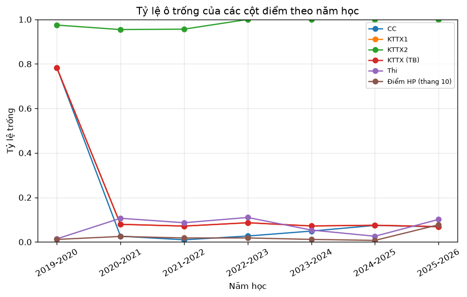

*Tỷ lệ ô trống của các cột điểm theo năm học*

### 1.4 Điểm 0

| cot | so_o_co_diem | so_diem_0 | ty_le_diem_0 |
|---|---|---|---|
| CC | 33,777 | 459 | 1.4% |
| KTTX1 | 32,712 | 543 | 1.7% |
| KTTX2 | 570 | 1 | 0.2% |
| KTTX (TB) | 32,712 | 541 | 1.7% |
| Thi | 35,518 | 509 | 1.4% |
| Điểm HP (thang 10) | 37,323 | 831 | 2.2% |

HP = 0 theo năm học và loại lớp:

| Năm học | loai_lop | so_sv | so_luot | so_hp_0 | ty_le_hp_0 |
|---|---|---|---|---|---|
| 2019-2020 | Lớp EP | 99 | 99 | 0 | 0.0% |
| 2019-2020 | Lớp thường | 739 | 3,588 | 46 | 1.3% |
| 2019-2020 | Đồ án/TT/KL | 159 | 162 | 30 | 18.5% |
| 2020-2021 | Lớp EP | 181 | 234 | 0 | 0.0% |
| 2020-2021 | Lớp thường | 1,011 | 4,530 | 119 | 2.6% |
| 2020-2021 | Đồ án/TT/KL | 251 | 264 | 34 | 12.9% |
| 2021-2022 | Lớp EP | 237 | 282 | 0 | 0.0% |
| 2021-2022 | Lớp thường | 1,235 | 4,668 | 43 | 0.9% |
| 2021-2022 | Đồ án/TT/KL | 298 | 308 | 15 | 4.9% |
| 2022-2023 | Lớp EP | 277 | 373 | 0 | 0.0% |
| 2022-2023 | Lớp thường | 1,228 | 4,621 | 125 | 2.7% |
| 2022-2023 | Đồ án/TT/KL | 291 | 301 | 31 | 10.3% |
| 2023-2024 | Lớp EP | 283 | 396 | 0 | 0.0% |
| 2023-2024 | Lớp thường | 1,312 | 4,596 | 69 | 1.5% |
| 2023-2024 | Đồ án/TT/KL | 306 | 326 | 32 | 9.8% |
| 2024-2025 | Lớp EP | 353 | 529 | 1 | 0.2% |
| 2024-2025 | Lớp thường | 1,405 | 5,044 | 84 | 1.7% |
| 2024-2025 | Đồ án/TT/KL | 334 | 371 | 54 | 14.6% |
| 2025-2026 | Lớp EP | 374 | 731 | 4 | 0.5% |
| 2025-2026 | Lớp thường | 1,446 | 5,606 | 113 | 2.0% |
| 2025-2026 | Đồ án/TT/KL | 256 | 294 | 31 | 10.5% |

HP = 0 đi kèm điểm Thi thế nào (gợi ý: HP=0 & Thi trống thường là vắng thi/bỏ học):

| kieu | so_sv | so_luot |
|---|---|---|
| HP=0, Thi = 0 | 152 | 287 |
| HP=0, Thi trống | 225 | 542 |

_Đã ẩn 1 nhóm có dưới 5 người (quy tắc riêng tư)._

| chi_so | gia_tri |
|---|---|
| Số lớp có điểm HP | 864 |
| Số lớp có ít nhất 1 HP = 0 | 329 |
| Số lớp có trên 20% HP = 0 | 24 |

## 2. Phân bố điểm

### 2.1 Phân bố điểm từng lượt (lớp thường)

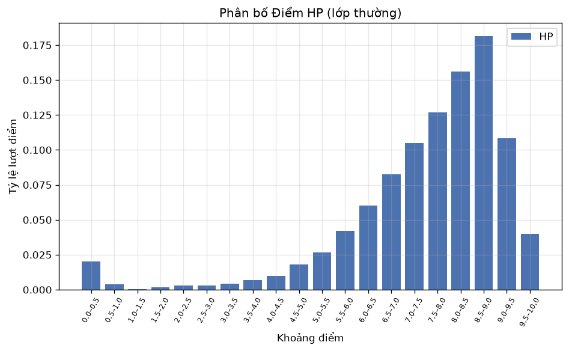

*Phân bố Điểm HP theo khoảng 0,5 điểm*

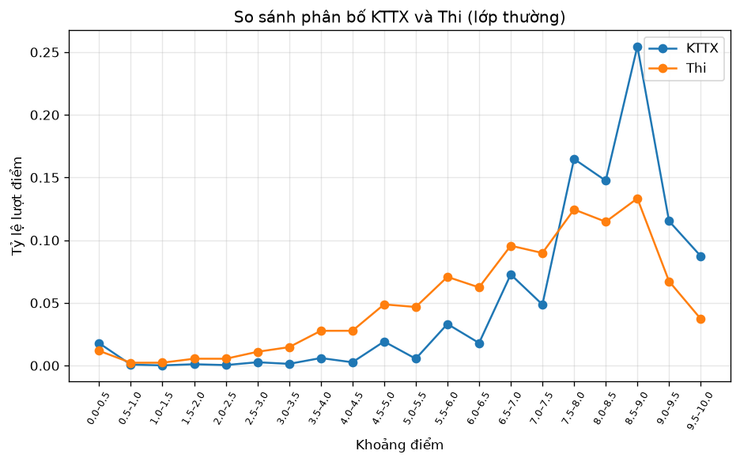

*KTTX (GV tự chấm) so với Thi (2 GV chấm)*

### 2.2 Chỉ số cấp lớp (lớp thường, ≥ 5 SV)

| chi_so | count | mean | std | min | 25% | 50% | 75% | max |
|---|---|---|---|---|---|---|---|---|
| tb (điểm TB lớp) | 702 | 7.668 | 0.790 | 3.494 | 7.167 | 7.711 | 8.226 | 9.406 |
| sigma (độ lệch chuẩn) | 702 | 1.236 | 0.421 | 0.199 | 0.948 | 1.227 | 1.490 | 2.713 |
| ty_le_A (0–1) | 702 | 0.355 | 0.249 | 0 | 0.162 | 0.302 | 0.500 | 1 |

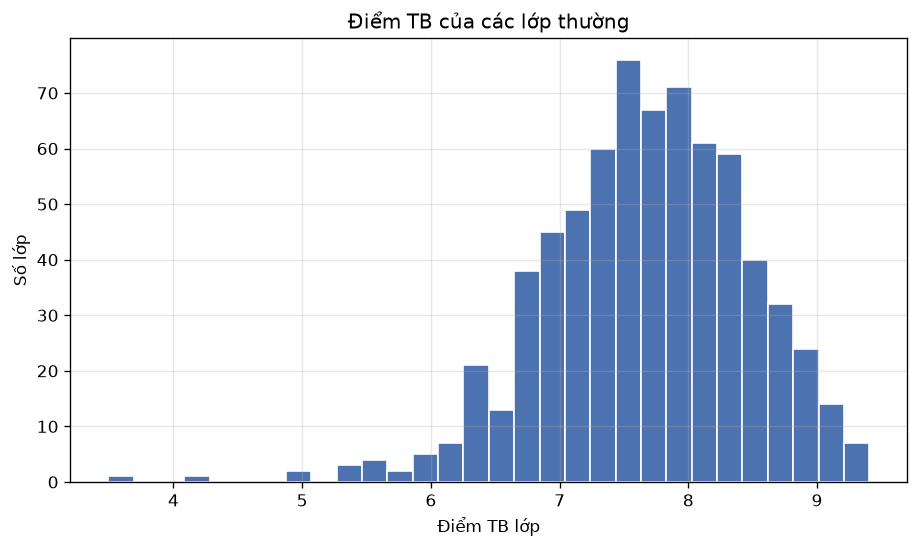

*Phân bố điểm TB lớp*

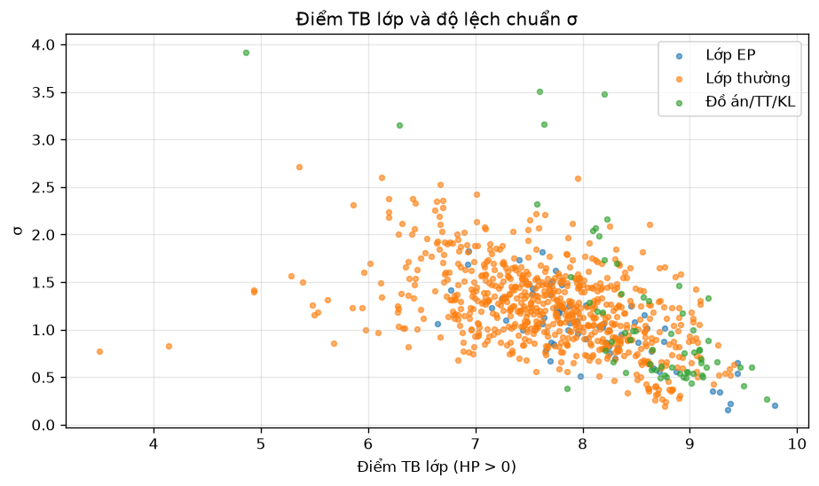

*Điểm TB lớp và σ (góc phải-dưới: điểm cao và đồng đều)*

### 2.3 Lớp có tỷ lệ A > 60%

| loai_lop | so_lop | so_luot | so_lop_vuot | ty_le_lop_vuot |
|---|---|---|---|---|
| Lớp EP | 62 | 2,639 | 18 | 29.0% |
| Lớp thường | 702 | 32,043 | 121 | 17.2% |
| Đồ án/TT/KL | 64 | 1,755 | 50 | 78.1% |

Lớp thường theo năm học:

| nam_hoc | so_lop | so_luot | so_lop_vuot | ty_le_lop_vuot |
|---|---|---|---|---|
| 2019-2020 | 85 | 3,533 | 2 | 2.4% |
| 2020-2021 | 107 | 4,411 | 7 | 6.5% |
| 2021-2022 | 95 | 4,625 | 18 | 18.9% |
| 2022-2023 | 99 | 4,496 | 8 | 8.1% |
| 2023-2024 | 93 | 4,527 | 18 | 19.4% |
| 2024-2025 | 101 | 4,958 | 25 | 24.8% |
| 2025-2026 | 122 | 5,493 | 43 | 35.2% |

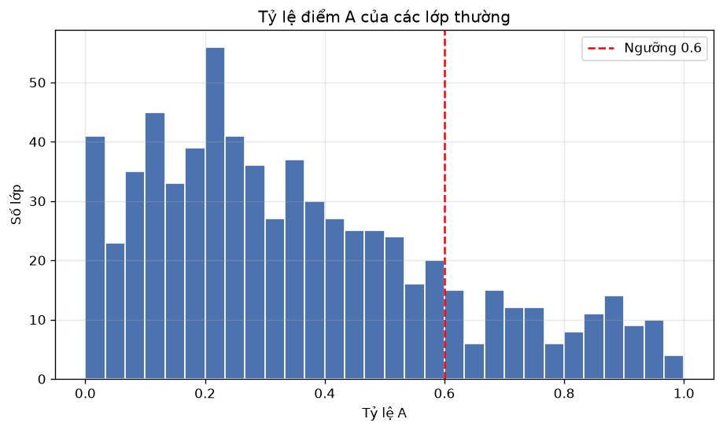

*Phân bố tỷ lệ điểm A, vạch đỏ = ngưỡng 60%*

15 lớp thường có tỷ lệ A cao nhất (ứng viên cho kịch bản video demo):

| Mã lớp học phần | ma_mon | nam_hoc | hoc_ky | loai_lop | n | tb | sigma | ty_le_A | tb_kttx | tb_thi |
|---|---|---|---|---|---|---|---|---|---|---|
| L0751 | M034 | 2020-2021 | 2 | Lớp thường | 55 | 8.767 | 0.199 | 100.0% | 8.709 | 8.709 |
| L0605 | M051 | 2021-2022 | 2 | Lớp thường | 56 | 8.896 | 0.283 | 100.0% | 8.857 | 8.857 |
| L0325 | M034 | 2021-2022 | 2 | Lớp thường | 50 | 8.838 | 0.375 | 100.0% | 8.770 | 8.770 |
| L0530 | M013 | 2024-2025 | 1 | Lớp thường | 52 | 8.902 | 0.303 | 98.1% | 8.913 | 8.731 |
| L0567 | M067 | 2023-2024 | 1 | Lớp thường | 58 | 8.774 | 0.238 | 96.6% | 8.733 | 8.716 |
| L0827 | M013 | 2025-2026 | 1 | Lớp thường | 56 | 9.050 | 0.912 | 96.4% | 8.902 | 9.173 |
| L0342 | M040 | 2025-2026 | 1 | Lớp thường | 53 | 9.019 | 0.886 | 96.2% | 9.113 | 8.906 |
| L0225 | M056 | 2025-2026 | 2 | Lớp thường | 40 | 9.260 | 0.843 | 95.0% | 8.938 | 9.749 |
| L0242 | M008 | 2025-2026 | 2 | Lớp thường | 58 | 9.098 | 1.301 | 94.8% | 9.280 | 8.836 |
| L0039 | M073 | 2021-2022 | 1 | Lớp thường | 19 | 8.916 | 1.581 | 94.7% | 9.026 | 8.816 |
| L0738 | M008 | 2024-2025 | 2 | Lớp thường | 57 | 9.375 | 0.526 | 94.7% | 9.316 | 9.404 |
| L0786 | M059 | 2025-2026 | 2 | Lớp thường | 34 | 9.406 | 0.636 | 94.1% | 9.118 | 9.647 |
| L0753 | M013 | 2025-2026 | 1 | Lớp thường | 48 | 8.990 | 0.878 | 93.8% | 8.812 | 8.990 |
| L0103 | M008 | 2025-2026 | 2 | Lớp thường | 32 | 9.216 | 0.427 | 93.8% | 9.281 | 9.109 |
| L0841 | M079 | 2025-2026 | 2 | Lớp thường | 43 | 9.051 | 1.423 | 93.0% | 9.058 | 8.930 |

10 lớp thường có σ nhỏ nhất (tiêu chí σ → 0):

| Mã lớp học phần | ma_mon | nam_hoc | hoc_ky | loai_lop | n | tb | sigma | ty_le_A | tb_kttx | tb_thi |
|---|---|---|---|---|---|---|---|---|---|---|
| L0751 | M034 | 2020-2021 | 2 | Lớp thường | 55 | 8.767 | 0.199 | 100.0% | 8.709 | 8.709 |
| L0567 | M067 | 2023-2024 | 1 | Lớp thường | 58 | 8.774 | 0.238 | 96.6% | 8.733 | 8.716 |
| L0521 | M034 | 2021-2022 | 2 | Lớp thường | 50 | 8.670 | 0.264 | 90.0% | 8.600 | 8.600 |
| L0377 | M034 | 2020-2021 | 2 | Lớp thường | 50 | 8.736 | 0.271 | 92.0% | 8.680 | 8.680 |
| L0605 | M051 | 2021-2022 | 2 | Lớp thường | 56 | 8.896 | 0.283 | 100.0% | 8.857 | 8.857 |
| L0530 | M013 | 2024-2025 | 1 | Lớp thường | 52 | 8.902 | 0.303 | 98.1% | 8.913 | 8.731 |
| L0453 | M067 | 2023-2024 | 1 | Lớp thường | 55 | 8.682 | 0.313 | 87.3% | 8.618 | 8.618 |
| L0647 | M067 | 2025-2026 | 1 | Lớp thường | 49 | 8.700 | 0.327 | 89.8% | 8.602 | 8.602 |
| L0687 | M051 | 2022-2023 | 2 | Lớp thường | 34 | 8.421 | 0.337 | 61.8% | 8.353 | 8.353 |
| L0739 | M067 | 2025-2026 | 1 | Lớp thường | 48 | 8.819 | 0.356 | 91.7% | 8.771 | 8.771 |

### 2.4 Sĩ số lớp

| si_so | so_lop |
|---|---|
| 1–4 | 31 |
| 5–14 | 40 |
| 15–29 | 66 |
| 30–49 | 340 |
| 50–79 | 398 |
| 80+ | 2 |

| chi_so | gia_tri |
|---|---|
| count | 877 |
| mean | 43.719 |
| std | 16.168 |
| min | 1 |
| 25% | 36 |
| 50% | 48 |
| 75% | 56 |
| max | 115 |

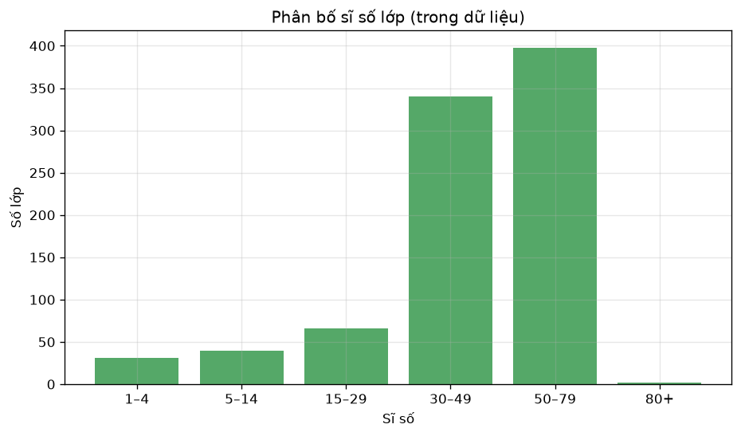

*Số lớp theo sĩ số*

## 3. Kiểm tra giả thuyết

### 3.1 Giả thuyết A – Chênh lệch KTTX − Thi theo lớp

| chi_so | gia_tri |
|---|---|
| Số lớp có KTTX và Thi (≥ 5 SV) | 691 |
| Số lớp tính được z (môn có ≥ 3 lớp khác) | 625 |
| TB chênh lệch KTTX − Thi (điểm) | 1.049 |
| Số lớp z > 2 (KTTX cao bất thường) | 35 |
| Số lớp z < −2 (KTTX thấp bất thường) | 22 |

| giai_doan | so_lop | so_luot | tb_kttx | tb_thi | chenh_tb |
|---|---|---|---|---|---|
| Trước HK2 2021-22 | 176 | 7,697 | 8.080 | 7.184 | 0.896 |
| Từ HK2 2021-22 | 515 | 23,540 | 8.403 | 7.302 | 1.101 |

15 lớp có KTTX cao bất thường nhất so với các lớp khác cùng môn:

| Mã lớp học phần | ma_mon | nam_hoc | hoc_ky | loai_lop | n | tb_kttx | tb_thi | chenh_tb | tb_chenh_lop_khac | z_chenh |
|---|---|---|---|---|---|---|---|---|---|---|
| L0244 | M014 | 2022-2023 | 2 | Lớp EP | 43 | 8.930 | 7.977 | 0.953 | 0.087 | 5.556 |
| L0427 | M066 | 2021-2022 | 2 | Lớp thường | 56 | 8.893 | 6.589 | 2.304 | 0.557 | 4.971 |
| L0745 | M004 | 2021-2022 | 2 | Lớp thường | 55 | 8.673 | 7.464 | 1.209 | 0.250 | 3.652 |
| L0640 | M057 | 2025-2026 | 1 | Lớp EP | 50 | 8.690 | 6.930 | 1.760 | -0.041 | 3.392 |
| L0095 | M082 | 2021-2022 | 2 | Lớp EP | 45 | 8.022 | 7.256 | 0.767 | -0.048 | 3.337 |
| L0141 | M062 | 2021-2022 | 2 | Lớp thường | 12 | 7.500 | 4.333 | 3.167 | 1.806 | 3.278 |
| L0864 | M087 | 2021-2022 | 3 | Lớp thường | 28 | 8.696 | 4.071 | 4.625 | 2.759 | 3.149 |
| L0496 | M043 | 2020-2021 | 2 | Lớp thường | 58 | 8.552 | 7.147 | 1.405 | 0.957 | 3.114 |
| L0873 | M059 | 2022-2023 | 1 | Lớp thường | 31 | 7.984 | 5.710 | 2.274 | 0.428 | 3.042 |
| L0620 | M079 | 2025-2026 | 1 | Lớp thường | 21 | 8.881 | 7.012 | 1.869 | 0.449 | 2.860 |
| L0177 | M080 | 2021-2022 | 2 | Lớp EP | 41 | 7.134 | 5.841 | 1.293 | -0.447 | 2.816 |
| L0456 | M013 | 2021-2022 | 2 | Lớp thường | 59 | 8.864 | 7 | 1.864 | 0.337 | 2.775 |
| L0614 | M002 | 2025-2026 | 1 | Lớp thường | 38 | 9.803 | 6.776 | 3.026 | 1.415 | 2.742 |
| L0695 | M002 | 2022-2023 | 2 | Lớp thường | 45 | 8.467 | 5.444 | 3.022 | 1.415 | 2.733 |
| L0233 | M085 | 2025-2026 | 2 | Lớp thường | 45 | 9.200 | 7.378 | 1.822 | -0.013 | 2.714 |

| cap_bien | so_lop | rho | p_value |
|---|---|---|---|
| chenh_tb ~ ty_le_A | 691 | -0.518 | <0.001 |
| z_chenh ~ ty_le_A | 625 | -0.202 | <0.001 |

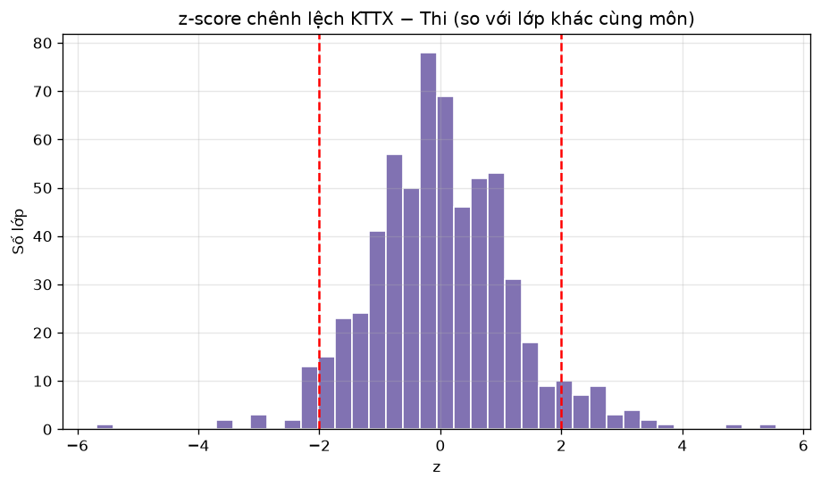

*z-score chênh lệch KTTX − Thi; ngoài hai vạch đỏ là bất thường*

### 3.2 Giả thuyết B – Trước và từ HK2 2021-22 (đổi trọng số)

| giai_doan | so_sv | so_lop | so_luot | tb_hp | sigma_hp | ty_le_A | tb_cc | tb_kttx | tb_thi |
|---|---|---|---|---|---|---|---|---|---|
| Trước HK2 2021-22 | 1,566 | 244 | 10,134 | 7.408 | 1.560 | 28.7% | 9.231 | 8.115 | 7.099 |
| Từ HK2 2021-22 | 3,306 | 467 | 21,920 | 7.842 | 1.444 | 40.1% | 9.246 | 8.359 | 7.220 |

| thanh_phan | so_luot_truoc | so_luot_sau | tb_truoc | tb_sau | chenh_sau_tru_truoc | t | p_value |
|---|---|---|---|---|---|---|---|
| Điểm HP | 10,134 | 21,920 | 7.408 | 7.842 | 0.433 | 23.673 | <0.001 |
| KTTX (TB) | 7,318 | 21,821 | 8.115 | 8.359 | 0.244 | 13.623 | <0.001 |
| Thi | 10,084 | 21,616 | 7.099 | 7.220 | 0.121 | 5.408 | <0.001 |
| CC | 7,327 | 21,853 | 9.231 | 9.246 | 0.015 | 1.213 | 0.225 |

So sánh trên cùng một môn ở hai giai đoạn:

| chi_so | gia_tri |
|---|---|
| Số môn có mặt ở cả hai giai đoạn | 36 |
| TB chênh lệch HP (sau − trước), điểm | 0.016 |
| Trung vị chênh lệch, điểm | 0.006 |
| Số môn tăng điểm | 18 |
| Số môn giảm điểm | 18 |
| p_value (Wilcoxon) | 0.834 |

| nhan_ky | so_sv | tb_hp | tb_kttx | tb_thi | ty_le_A |
|---|---|---|---|---|---|
| 2019-2020 HK1 | 630 | 6.908 | 7.445 | 6.741 | 15.1% |
| 2019-2020 HK2 | 548 | 7.027 | 7.573 | 6.910 | 20.1% |
| 2020-2021 HK1 | 941 | 7.192 | 7.960 | 6.737 | 22.8% |
| 2020-2021 HK2 | 784 | 7.657 | 8.209 | 7.309 | 33.7% |
| 2020-2021 HK3 | 176 | 8.110 | 8.449 | 7.805 | 49.7% |
| 2021-2022 HK1 | 904 | 8.014 | 8.342 | 7.601 | 45.2% |
| 2021-2022 HK2 | 942 | 7.719 | 8.255 | 7.129 | 36.7% |
| 2021-2022 HK3 | 194 | 7.687 | 8.214 | 7.140 | 38.0% |
| 2022-2023 HK1 | 866 | 7.371 | 7.954 | 6.631 | 25.0% |
| 2022-2023 HK2 | 879 | 7.716 | 8.083 | 7.239 | 37.9% |
| 2022-2023 HK3 | 5 | 6.280 | 7.800 | 4.450 | 0.0% |
| 2023-2024 HK1 | 1,007 | 7.788 | 8.282 | 7.113 | 36.5% |
| 2023-2024 HK2 | 911 | 7.942 | 8.225 | 7.482 | 44.5% |
| 2024-2025 HK1 | 1,177 | 7.981 | 8.693 | 7.129 | 41.5% |
| 2024-2025 HK2 | 898 | 7.790 | 8.319 | 7.100 | 38.8% |
| 2025-2026 HK1 | 1,215 | 8.105 | 8.601 | 7.490 | 47.8% |
| 2025-2026 HK2 | 927 | 8.081 | 8.674 | 7.517 | 48.3% |
| 2025-2026 HK3 | 35 | 3.494 | – | 6.977 | 0.0% |

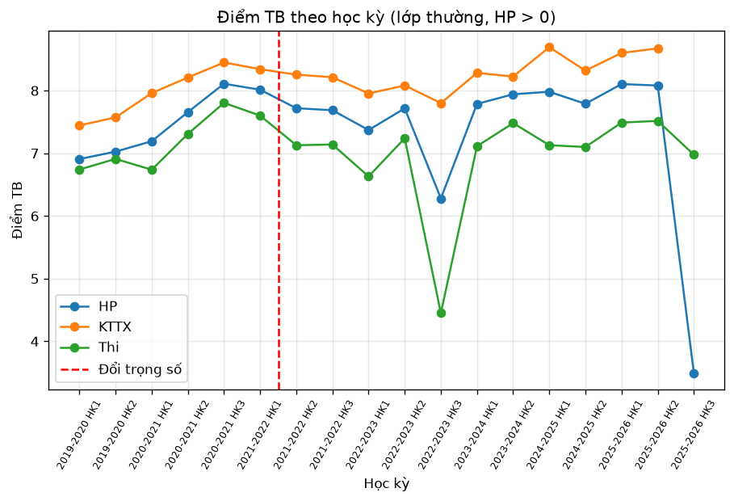

*Điểm TB theo học kỳ; vạch đỏ = mốc đổi trọng số*

Cơ cấu trọng số (suy ra) phổ biến nhất mỗi giai đoạn:

| giai_doan | co_cau_trong_so | so_luot | so_sv | ty_le_trong_giai_doan |
|---|---|---|---|---|
| Trước HK2 2021-22 | 10/20/70 | 6,800 | 1,236 | 61.8% |
| Trước HK2 2021-22 | (trống) | 3,302 | 947 | 30.0% |
| Trước HK2 2021-22 | 10/40/50 | 621 | 435 | 5.6% |
| Trước HK2 2021-22 | 10/0/90 | 174 | 174 | 1.6% |
| Trước HK2 2021-22 | 0/40/60 | 56 | 56 | 0.5% |
| Trước HK2 2021-22 | 5/25/70 | 34 | 34 | 0.3% |
| Từ HK2 2021-22 | 10/40/50 | 14,966 | 2,765 | 59.3% |
| Từ HK2 2021-22 | (trống) | 8,334 | 2,860 | 33.0% |
| Từ HK2 2021-22 | 10/0/90 | 937 | 933 | 3.7% |
| Từ HK2 2021-22 | 10/20/70 | 627 | 413 | 2.5% |
| Từ HK2 2021-22 | 0/50/50 | 159 | 149 | 0.6% |
| Từ HK2 2021-22 | 20/20/60 | 90 | 89 | 0.4% |

### 3.3 Giả thuyết C – Lớp EP, đồ án và lớp thường

| loai_lop | so_lop | so_sv | so_luot | ty_le_dat | ty_le_hp_0 | tb_hp | sigma_hp | ty_le_A | ty_le_trong_CC | ty_le_trong_KTTX |
|---|---|---|---|---|---|---|---|---|---|---|
| Lớp EP | 62 | 988 | 2,644 | 98.6% | 0.2% | 8.045 | 1.282 | 44.4% | 2.8% | 2.9% |
| Lớp thường | 712 | 4,051 | 32,653 | 94.9% | 1.8% | 7.705 | 1.495 | 36.5% | 10.1% | 10.3% |
| Đồ án/TT/KL | 90 | 1,070 | 2,026 | 86.8% | 11.2% | 8.648 | 1.235 | 74.4% | 52.6% | 100.0% |

| so_sanh | so_luot_nhom | chenh_tb_hp | t | p_value |
|---|---|---|---|---|
| Lớp EP vs Lớp thường | 2,639 | 0.340 | 12.933 | <0.001 |
| Đồ án/TT/KL vs Lớp thường | 1,799 | 0.943 | 31.138 | <0.001 |

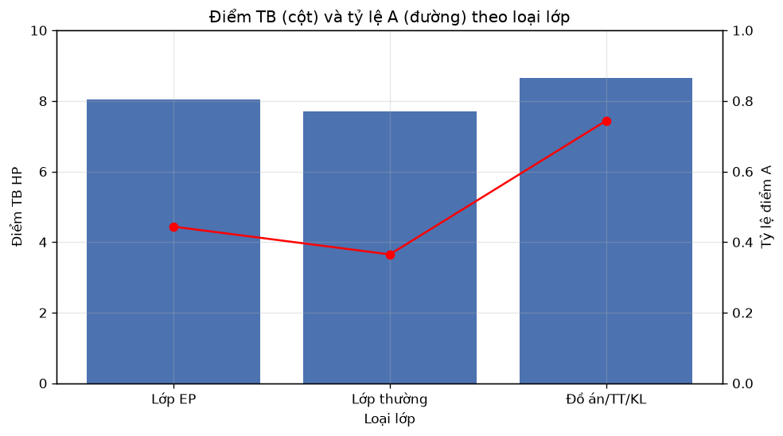

*Điểm TB và tỷ lệ A theo loại lớp*

## 4. Năng lực nền – số môn mỗi sinh viên đã học

| chi_so | gia_tri |
|---|---|
| Số SV | 5,039 |
| TB số môn | 6.883 |
| Phân vị 5% | 1 |
| Phân vị 10% | 1 |
| Phân vị 25% | 1 |
| Phân vị 50% | 3 |
| Phân vị 75% | 11 |
| Phân vị 90% | 22 |
| Phân vị 95% | 24 |

| so_mon | so_sv |
|---|---|
| 1 | 1,268 |
| 2 | 1,167 |
| 3–4 | 953 |
| 5–9 | 333 |
| 10–14 | 225 |
| 15–19 | 345 |
| 20–29 | 748 |

_Đã ẩn 1 nhóm có dưới 5 người (quy tắc riêng tư)._

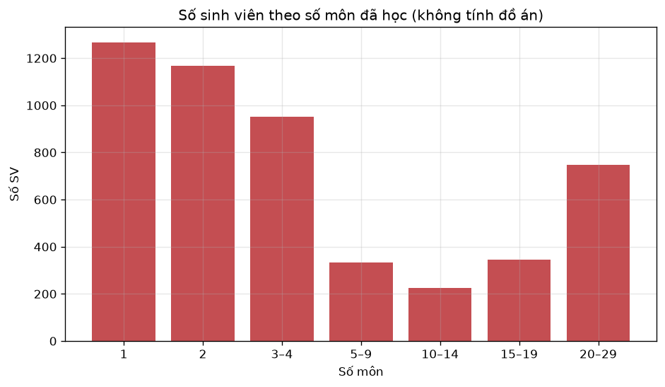

*Số SV theo số môn đã học*

Tỷ lệ SV và lượt điểm có đủ môn KHÁC để tính năng lực nền:

| so_mon_khac_toi_thieu | so_sv | ty_le_sv | ty_le_luot |
|---|---|---|---|
| 1 | 3,771 | 74.8% | 96.4% |
| 3 | 1,954 | 38.8% | 84.1% |
| 5 | 1,456 | 28.9% | 77.8% |

Theo khóa tuyển sinh:

| khoa_sv | so_sv | tb_so_mon | trung_vi_so_mon |
|---|---|---|---|
| (trống) | 14 | 2.714 | 1 |
| K56 | 9 | 2 | 1 |
| K57 | 20 | 1.900 | 1.500 |
| K58 | 79 | 5.886 | 6 |
| K59 | 129 | 11.372 | 16 |
| K60 | 350 | 10.517 | 4 |
| K61 | 545 | 9.094 | 4 |
| K62 | 550 | 8.751 | 4 |
| K63 | 606 | 7.619 | 3 |
| K64 | 681 | 7.173 | 3 |
| K65 | 750 | 6.404 | 2 |
| K66 | 866 | 4.508 | 2 |
| K67 | 439 | 2.267 | 3 |

_Đã ẩn 1 nhóm có dưới 5 người (quy tắc riêng tư)._

## Ghi chú cuối

Tổng số nhóm đã ẩn vì dưới 5 người: 3. Thời gian chạy: 2.2 giây cho 38,342 dòng.
